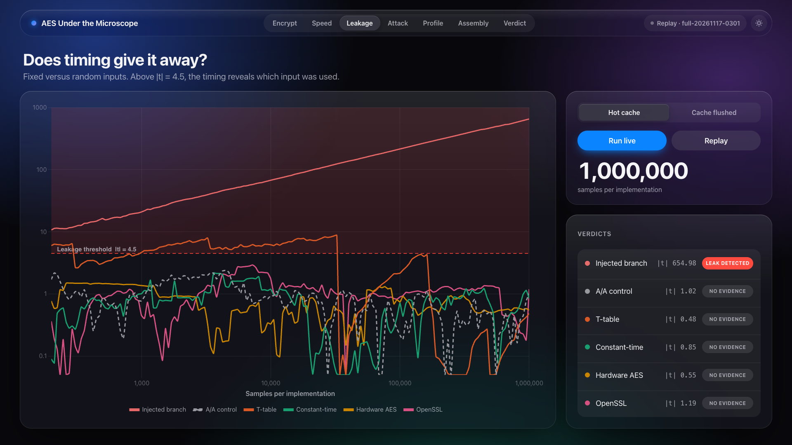
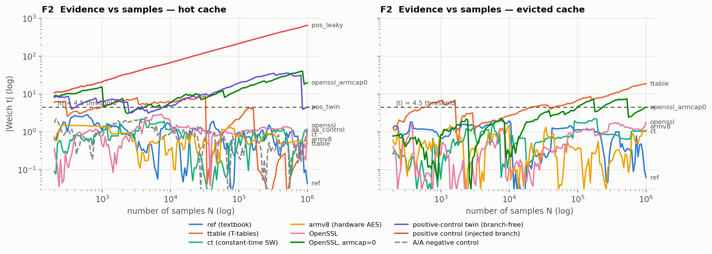
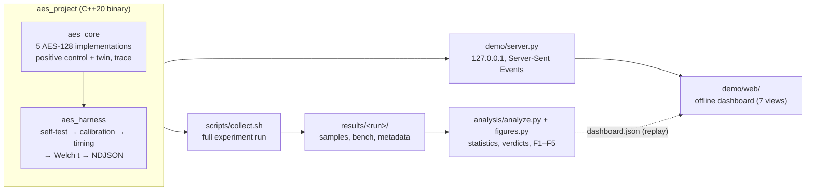
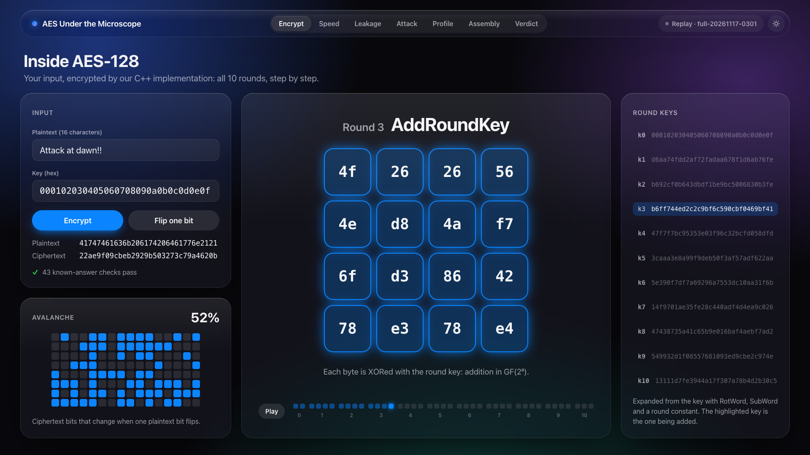
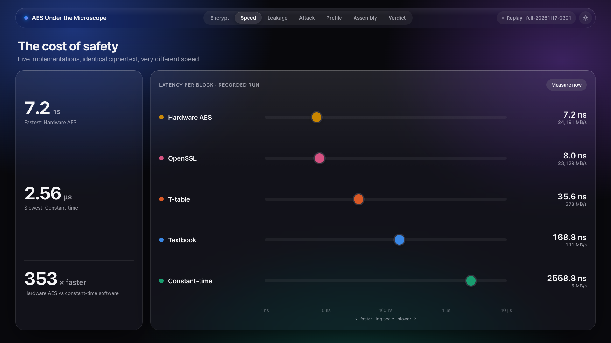
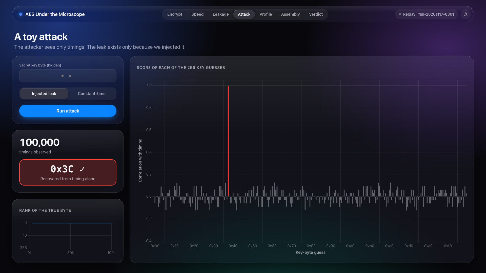
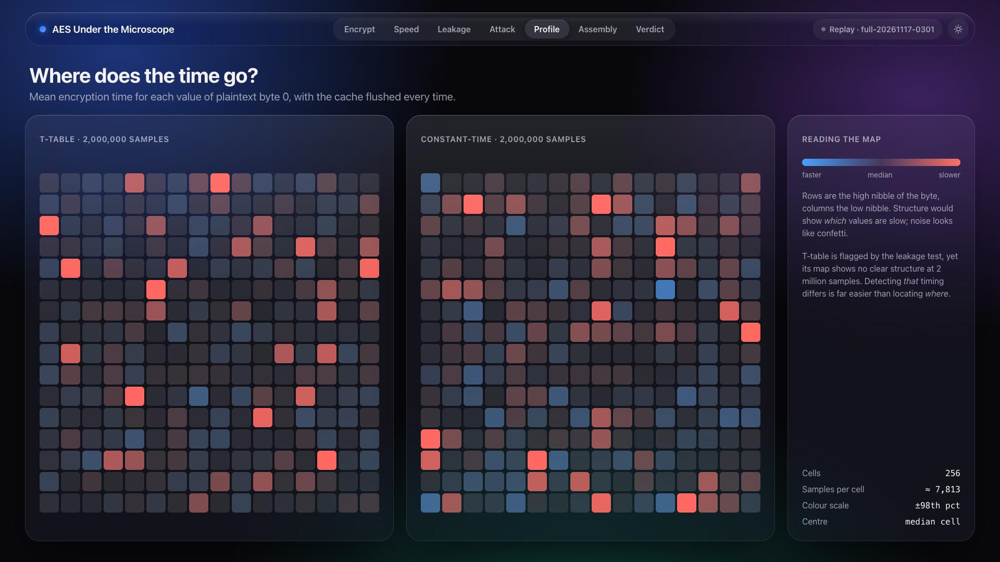
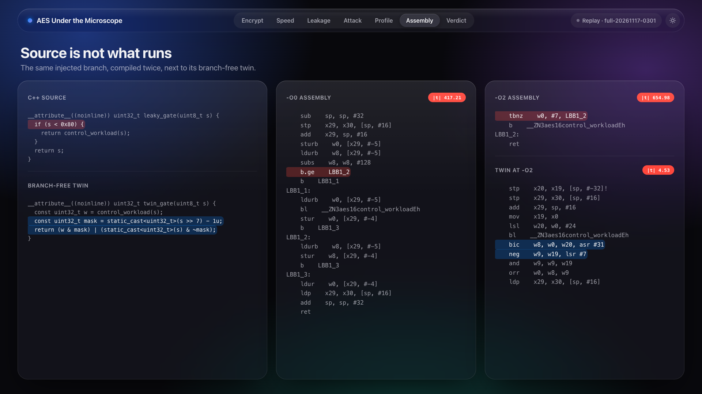
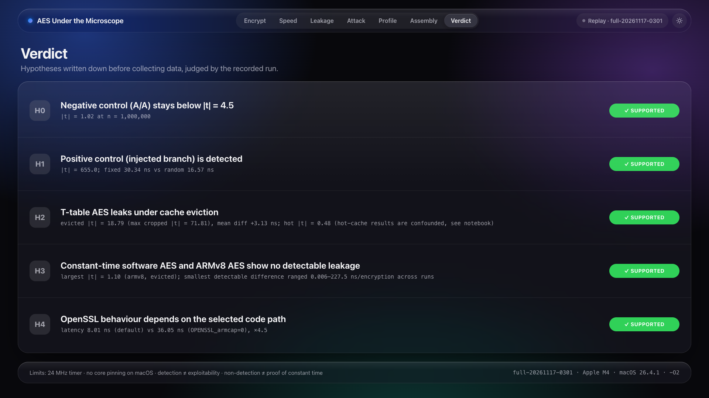

# AES Under the Microscope

**Same cipher. Same output. Different timing?**
An experimental study of timing side-channel leakage in five AES-128 implementations on Apple M4.

Part I of **ChronoLeak**, a two-part project on timing leakage in cryptographic code.
Course project for *Cryptography and Network Security*, National Institute of Technology Warangal.
Author: Bibek Chaudhary (23ECB0F33). Guide: Prof. Sourabh Solanki.



| 📄 Report (PDF) | 🎞️ Slides (PDF) | 📊 Recorded results | 🧪 Lab notebook |
|---|---|---|---|
| [ChronoLeak_Report_23ECB0F33.pdf](report/ChronoLeak_Report_23ECB0F33.pdf) | [slides.pdf](presentation/slides.pdf) | [summary.md](results/full-20261117-0301/summary.md) | [lab_notebook.md](report/lab_notebook.md) |

---

## Contents

1. [The problem](#the-problem)
2. [Key results](#key-results)
3. [The cryptography](#the-cryptography)
4. [How the measurement works](#how-the-measurement-works)
5. [Architecture](#architecture)
6. [Screenshots](#screenshots)
7. [Getting started](#getting-started)
8. [Reproducing the experiments](#reproducing-the-experiments)
9. [Command-line interface](#command-line-interface)
10. [Testing](#testing)
11. [Findings in detail](#findings-in-detail)
12. [Limitations](#limitations)
13. [Security takeaways](#security-takeaways)
14. [Future work and Part II: ChronoLeak](#future-work-and-part-ii-chronoleak)
15. [Repository layout](#repository-layout)
16. [Documents](#documents)
17. [References, libraries and AI tools](#references-libraries-and-ai-tools)

---

## The problem

AES has withstood more than 25 years of cryptanalysis. Attacks on deployed AES go after the **implementation**, not the maths. If the time an encryption takes depends on the key, an attacker who can measure that time can learn the key. Kocher showed this for public-key code in 1996. Bernstein (2005) and Osvik, Shamir and Tromer (2006) then showed that fast table-based AES leaks key material through the CPU cache.

The standard defence is *constant-time* code: no branches and no memory addresses that depend on secret data. But two things sit between the source code and the running program:

- **the compiler**, which has no notion of time and may rewrite "safe" code, and
- **the processor**, whose caches, prefetchers and predictors can make even constant-time machine code behave differently for different data. Recent work on Apple chips (GoFetch, SLAP, FLOP) shows this.

**Research question.** On Apple M4, do different AES-128 implementation strategies show statistically detectable data-dependent timing under a standard fixed-vs-random leakage test? And how much of the outcome comes from the source code, the compiled machine code, and the microarchitecture?

**Objectives**

1. Implement AES-128 in several strategies that give identical ciphertext but differ in side-channel properties, and validate them against FIPS-197 and SP 800-38A.
2. Build a measurement system with a standard leakage test (TVLA/dudect), and prove it works with positive and negative controls.
3. Measure every implementation on real hardware, check each conclusion against the assembly, and state what the measurements cannot show.
4. Use the results to define the next research step (Part II, ChronoLeak).

---

## Key results

| Implementation | Strategy | Latency | Leakage, evicted cache (\|t\|, 10⁶ samples) |
|---|---|---|---|
| `ref` | Textbook FIPS-197, 256 B S-box table | 169 ns | 0.06 |
| `ttable` | 4 × 1 KB T-tables | 36 ns | **18.8: leak detected** (+3.1 ns per encryption) |
| `ct` | Constant-time, S-box computed as affine(a²⁵⁴) | 2,559 ns | 1.05 |
| `armv8` | ARMv8 `AESE`/`AESMC` hardware instructions | **7.2 ns** | 1.10 |
| `openssl` | OpenSSL 3.6.1 EVP (hardware path by default) | 8.0 ns | 1.79 |

**Controls.** The injected secret-dependent branch (positive control) gives **\|t\| = 655**. The random-vs-random A/A negative control gives **\|t\| = 1.02**. The threshold is \|t\| > 4.5.

| Hypothesis (written before collecting data) | Verdict |
|---|---|
| H0: the A/A negative control stays below \|t\| = 4.5 | ✔ 1.02 |
| H1: the injected branch is detected | ✔ 655 |
| H2: T-table AES leaks when the cache is flushed | ✔ 18.8 |
| H3: `ct` and `armv8` show no detectable leakage | ✔ ≤ 1.10 |
| H4: OpenSSL's behaviour depends on its code path | ✔ hardware 8.0 ns vs. C fallback 36.1 ns, and the fallback is flagged |

In one sentence: **hardware AES is the fastest implementation and showed no detectable leakage, while T-table AES leaks as soon as the cache is flushed**, even on a processor with a 128 KB L1 cache.



> ⚠️ `ref` and `ttable` are **educational and not suitable for protecting real secrets**. The positive control is an **intentionally injected** vulnerability, not a weakness of AES. ECB mode is used only as a single-block measurement interface. The project makes no key-recovery claim against AES.

---

## The cryptography

**AES-128.** The cipher works on a 128-bit block arranged as a 4×4 byte *state*. The 16-byte key expands into 11 round keys (RotWord, SubWord, Rcon). After an initial AddRoundKey come 10 rounds of SubBytes → ShiftRows → MixColumns → AddRoundKey. The last round omits MixColumns, which is linear and would add nothing there.

**GF(2⁸).** Bytes are polynomials modulo the irreducible polynomial *m(x) = x⁸ + x⁴ + x³ + x + 1* (0x11B).

- Addition is XOR.
- Multiplication by *x* is `xtime(a) = (a≪1) ⊕ (0x1B·a₇)`. Here it is implemented with a mask, not an `if`.
- The **S-box**, the only non-linear step, is S(a) = A(a⁻¹) ⊕ 0x63. Since the multiplicative group has order 255, **a⁻¹ = a²⁵⁴**.
- MixColumns multiplies each column by an MDS matrix, which gives full diffusion after two rounds.

**Why some implementations leak.**

| Mechanism | Example | Where it appears here |
|---|---|---|
| Secret-dependent **branch** | `if (secret) do_more_work();` | the injected positive control |
| Secret-dependent **memory address** | `T[state_byte]` touches a cache line chosen by the key | `ref` (256 B S-box) and `ttable` (4 KB of tables, 160 lookups per block) |

**How the safe implementations avoid it.**

- **`ct`** computes the S-box arithmetically as A(a²⁵⁴), eight bytes at once (SWAR). It uses no tables and no branches: the S-box is 917 straight-line instructions with 0 branches and 0 indexed loads.
- **`armv8`** uses the CPU's AES instructions, where the S-box lives inside the execution unit.

---

## How the measurement works

This is the **fixed-vs-random test** (TVLA 2011, dudect 2017):

1. For each of N = 10⁶ samples, a coin flip chooses the **fixed** class (all-zero plaintext) or the **random** class (a fresh random plaintext).
2. Both classes are prepared by identical instructions outside the timed region, so they cannot differ in how their input reaches memory.
3. *(Evicted condition only)* A 4 MB buffer is read to flush the cache, then a single encryption is timed (B = 1).
4. *(Hot condition)* B back-to-back encryptions are timed. B is calibrated so that a sample lasts about 2.5 µs, because one encryption is shorter than one timer tick.
5. Time is read with `mach_absolute_time()` between two `isb` barriers: a 24 MHz counter, 41.67 ns per tick.
6. The two timing distributions are compared with **Welch's t**:

   t = (x̄_F − x̄_R) / √(s²_F/n_F + s²_R/n_R),  and |t| > 4.5 ⇒ leakage detected.

The primary statistic was fixed in advance. The other statistics are reported alongside it, never instead of it:

- cropped t at the 50th, 90th and 99th percentiles
- Mann–Whitney U and Kolmogorov–Smirnov tests
- Cohen's d
- Holm-adjusted p-values across all 19 tests
- the **minimum detectable difference**, which bounds every non-detection

---

## Architecture



| Component | What it does |
|---|---|
| **`aes_core`** (`src/aes_*.cpp`, `controls.cpp`, `trace.cpp`, `factory.cpp`) | The five implementations behind one `Aes128` interface, plus the positive control, its branch-free twin, and a round-by-round tracer. Contains no timing code. |
| **`aes_harness`** (`timer.cpp`, `harness.cpp`, `bench.cpp`, `selftest.cpp`, `metadata.cpp`, `json_out.cpp`) | The fixed-vs-random protocol, cache eviction, batch calibration, running Welch statistics, benchmarks, run metadata and NDJSON output. |
| **`aes_project`** (`main.cpp`) | One CLI with 10 commands. It **refuses to measure until the known-answer self-test passes**. |
| **Analysis** (`analysis/`) | Recomputes every statistic from the raw samples, independently of the C++ code. Adds the robust tests, applies the hypothesis verdicts and draws figures F1–F5. |
| **Dashboard** (`demo/`) | A standard-library Python server bound to localhost. It starts the binary with a fixed argument list and validated inputs, and streams its output to a vanilla-JS page. Works fully offline. *Replay* mode shows the recorded run. |

**Implementation details**

- C++20, about 2,700 lines.
- Build: CMake, Apple Clang 21, `-O2 -mcpu=apple-m4` with strict warnings. There is also an `-O0` build for the compiler experiment and an ASan + UBSan build.
- `do_not_optimize` / `clobber_memory` keep the measured work from being optimised away.
- Randomness: `mt19937_64` with a recorded seed, so runs are reproducible. It is not a cryptographic RNG, and the key is a public test key.
- The thread runs at QoS `USER_INTERACTIVE` to bias it towards performance cores.

---

## Screenshots

| | |
|---|---|
|  **Encrypt:** your text through all 10 rounds, round keys and the avalanche effect |  **Speed:** the cost of safety, from 7 ns to 2.5 µs |
|  **Attack:** a key byte recovered from timing alone (injected leak only) |  **Profile:** mean time per plaintext byte under eviction |
|  **Assembly:** the branch survives as `tbnz` at -O2, the twin uses a mask |  **Verdict:** each hypothesis judged against the recorded run |

---

## Getting started

**Requirements**

- macOS on Apple Silicon (developed on an M4 with macOS 26.4.1)
- Apple Clang (Xcode command-line tools) and CMake ≥ 3.20
- OpenSSL 3: `brew install openssl@3`. macOS ships LibreSSL without OpenSSL headers.
- Python 3.10+ for the analysis. `scripts/analyze.sh` creates `.venv` automatically.
- *(optional)* Tectonic, to rebuild the PDFs: `brew install tectonic`

**Quick start**

```bash
git clone https://github.com/bibek198/AES-Under-the-Microscope.git
cd AES-Under-the-Microscope

scripts/build.sh                 # Release build: -O2 -mcpu=apple-m4
build/aes_project test           # FIPS-197 / SP 800-38A self-test (43 checks)
build/aes_project info           # platform, caches, 24 MHz timer, OpenSSL code path
scripts/demo.sh                  # interactive dashboard at http://127.0.0.1:8765
```

**Live demo.** Run `scripts/demo.sh --preflight` first. It checks the binary, the port, AC power, Low Power Mode and Wi-Fi, and prints *ALL GO* when the machine is ready. The full demo script and fallbacks are in [demo/CHECKLIST.md](demo/CHECKLIST.md). In the dashboard, press **F** for fullscreen, **T** to toggle the theme, and **R** to replay the recorded run.

---

## Reproducing the experiments

```bash
scripts/collect.sh               # ~6 minutes: all experiments, -O0 build, OPENSSL_armcap=0, assembly, analysis
scripts/collect.sh --quick       # ~1 minute, 10⁵ samples per test
scripts/analyze.sh               # re-run the analysis on results/latest
scripts/asm.sh                   # regenerate the assembly listings
scripts/docs.sh                  # rebuild the LaTeX report and slides
```

Run on AC power with other apps closed, and leave the Mac alone while it runs. Each run writes `results/<run_id>/`:

| File | Contents |
|---|---|
| `metadata.json` | CPU, caches, OS, compiler flags, OpenSSL path, timer, power state, git commit |
| `bench.jsonl` | Latency and throughput |
| `samples_*.csv` | Raw ticks per sample (gitignored: about 340 MB) |
| `summary.md` / `.csv` / `.json` | All statistics and the H0–H4 verdicts |
| `figures/` | F1–F5 (PNG + SVG) |
| `dashboard.json` | Replay data for the demo |

---

## Command-line interface

```
aes_project test | info
aes_project bench    [--impl X|all] [--quick]
aes_project leakage  [--impl X|all] [--cond hot|evicted|both] [--n N]
aes_project controls [--n N]
aes_project race     [--cond hot|evicted] [--n N]      # interleaved, for the dashboard
aes_project trace    --pt HEX --key HEX                 # every intermediate state
aes_project profile  --impl X --cond C [--n N]
aes_project recover  --target leaky|ct --key-byte XX    # toy recovery, injected branch only
aes_project all      [--quick] [--out DIR]
Global: --json (NDJSON) · --stream · --seed S · --batch B · --no-color
```

Implementations: `ref`, `ttable`, `ct`, `armv8`, `openssl` (plus the controls `pos_leaky` and `pos_twin`).

---

## Testing

```bash
scripts/test.sh                  # ctest suites in Release and under ASan + UBSan
scripts/e2e.sh                   # 110-check end-to-end suite: CLI, pipeline, server, dashboard
```

| Test | Result |
|---|---|
| FIPS-197 C.1, Appendix B (with intermediate states), A.1 key expansion | ✔ all 7 variants |
| NIST SP 800-38A F.1.1 ECB-AES128, blocks 1–4 | ✔ all 7 variants |
| Computed S-box = table S-box on all 256 inputs; no fixed points | ✔ |
| GF(2⁸): FIPS-197 examples; a·a⁻¹ = 1 for every a ≠ 0 | ✔ |
| 100,000 random (key, plaintext) pairs: all implementations agree | ✔ |
| Debug build under AddressSanitizer + UndefinedBehaviorSanitizer | ✔ no findings |

---

## Findings in detail

- **The cache condition decides it.** In a hot loop, all 4 KB of T-tables stay in the M4's 128 KB L1 cache and the T-table timing shows nothing (\|t\| = 0.48). Flush the cache before every encryption and it leaks: 3.1 ns on an 81 ns operation, above the threshold after about 4.5 × 10⁴ samples.
- **Small tables leak far less.** The textbook `ref` implementation did not leak even under eviction. Its 256-byte S-box is only two 128-byte cache lines.
- **Non-detections are bounded, not proven.** For `armv8` with a hot cache, any mean difference above 0.006 ns would have been detected. Under eviction the bound is weak (22.6 ns for `armv8`, 227.5 ns for `ct`), because one encryption is shorter than one timer tick.
- **OpenSSL picks the safe path by default.** Debugger breakpoints show `aes_v8_ecb_encrypt` (hardware). With `OPENSSL_armcap=0` it falls back to the portable table-based `AES_encrypt`, which is 4.5× slower and flagged.
- **Source ≠ machine code.** The injected `if` survives as `tbnz w0, #7` at `-O2` and as `subs; b.ge` at `-O0`, and is detected at both. Clang rewrote one multiplication in `ct` into shift-and-subtract but kept it branch-free.
- **Detecting is easier than exploiting.** A toy correlation attack recovers a secret byte from timing alone, but only against the injected branch. Against `ct` the true byte ranked 77th of 256, consistent with noise. Even with 2 × 10⁶ evicted samples, the per-byte profile of T-table AES shows no visible structure.
- **An unexpected result.** Branch-free code that performs a data-dependent load was flagged in the *hot, long-batch* regime (\|t\| ≈ 4.5–14).
  - It is not caused by input preparation or by the choice of fixed value.
  - It is absent at B ≤ 10.
  - The investigation is recorded step by step in the [lab notebook](report/lab_notebook.md). The mechanism is **unexplained**: persistent predictor state is plausible (compare SLAP and FLOP) but unconfirmed.
  - Because of this, the cache conclusions rest on the evicted runs, and hot-cache detections of table-based code are treated as inconclusive.

---

## Limitations

- **24 MHz timer** (41.67 ns): samples are batched, and single-encryption evicted samples are heavily quantised, so non-detection bounds are weak there.
- **No cycle counters.** On Apple Silicon they need private frameworks and root.
- **No core pinning** on macOS, only a QoS hint. The P-core/E-core placement of each sample is unknown.
- **One machine, one OS build, one compiler, one fixed plaintext and key.**
- **Attacker model:** in-process, with an idealised whole-cache eviction. No cross-process or remote attack was attempted.
- **The hot-regime effect is unexplained** (see above).
- **Statistical detection is not exploitability, and non-detection is not a proof of constant time.**
- **Live dashboard runs are illustrative** (the browser competes for the CPU). All reported numbers come from the recorded run `full-20261117-0301`.

---

## Security takeaways

1. **Don't use table-based AES where an attacker can influence the cache.** Even on a large-L1 machine, eviction exposed the leak within about 4.5 × 10⁴ measurements.
2. **Use hardware AES, or a vetted library that uses it, and check that the hardware path is actually selected.** OpenSSL's fallback is table-based.
3. **"Constant-time" is a property of machine code on a specific CPU, not of source code.** Inspect the assembly, then test empirically and state the sensitivity of the test.
4. **Leakage tests need controls.** Without the A/A control the harness could not be shown to be calibrated. Without the positive control it could not be shown to detect anything. Without the branch-free twin, the hot-regime confound would have gone unnoticed.

---

## Future work and Part II: ChronoLeak

**Extending Part I**

- cycle-accurate measurement with performance counters
- running whole implementations with DIT (Data-Independent Timing) enabled
- a Prime+Probe attacker model, to locate *which* byte values are slow
- bit-sliced or vector-permute constant-time AES, to close the 353× performance gap
- identifying the mechanism behind the hot-regime effect

**Part II: ChronoLeak (research plan).** Part I showed that constant-time behaviour is decided by the compiler and the processor. Compiler-induced violations have been studied at scale for **C** (Breaking Bad, ASIA CCS 2025; Fun with Flags, PriSC 2026; DOCC, FC 2025). The constant-time mechanisms **specific to Rust** have not been measured:

- `subtle::Choice` with its volatile barrier, versus the `core_hint_black_box` feature
- the point where a `Choice` is turned back into a `bool`
- naive idioms such as `==` on slices
- Rust build settings: MIR optimisation, monomorphisation, codegen-units, LTO, target features

| | |
|---|---|
| **Central question** | How do Rust constant-time mechanisms and rustc/LLVM settings preserve or break secret-independent execution, and when do the violations become *measurable* at runtime? |
| **Research questions** | RQ1: do barriers survive across settings? RQ2: which stage or pass is responsible? RQ3: which violations are measurable on real hardware? (the centre of the study) RQ4: effect of architecture and load |
| **Targets** | `subtle`, `curve25519-dalek` (per backend), `k256`, and `ml-dsa` before and after RUSTSEC-2025-0144 as a known positive control |
| **Design** | Stage A: screen a fractional design of the 1,440 possible builds with a taint analyser and assembly diffs. Stage B: dudect-style timing of flagged builds, controls and a random sample of unflagged builds, on bare-metal Linux x86-64 and AArch64, reporting the minimum detectable effect for every non-detection |
| **Software** | 4 Rust crates (`chrono-core`, `chrono-measure`, `chrono-stats`, `chrono-cli`), Python for statistics, existing analysers (ctgrind-style taint, MicroWalk) |
| **Gates** | Week 5: Linux platform and analyser ready. Week 8: `subtle` pilot. The pilot's possible outcomes (expand, reframe or stop) are fixed in advance |

The full plan, with hypotheses, roadmap and risks, is Chapter 6 of the [report](report/ChronoLeak_Report_23ECB0F33.pdf).

---

## Repository layout

```
include/, src/        AES implementations, measurement harness, CLI (C++20)
tests/                known-answer, differential and control tests (ctest); e2e/ end-to-end suite
analysis/             statistics (Welch, crops, Mann–Whitney, KS, bootstrap, Holm) and figures
assembly/             generated listings and annotated inspection notes (README.md)
results/              recorded run full-20261117-0301: summaries, figures, replay data
report/               ChronoLeak_Report_23ECB0F33.pdf, latex/ (sources), report.md, lab_notebook.md
presentation/         slides.pdf, beamer/ (sources), slides-marp.* (earlier Marp version), speaker notes, img/
demo/                 offline dashboard: stdlib Python server, vanilla JS, Chart.js (vendored)
scripts/              build, test, e2e, collect, analyze, asm, demo, docs
CMakeLists.txt        build configuration (AES_OPT_LEVEL, AES_SANITIZE)
```

---

## Documents

| Document | Description |
|---|---|
| [report/ChronoLeak_Report_23ECB0F33.pdf](report/ChronoLeak_Report_23ECB0F33.pdf) | Full LaTeX report, 55 pages: background, literature review, Part I system and results, Part II plan. Source: [report/latex/](report/latex/) |
| [presentation/slides.pdf](presentation/slides.pdf) | 23-slide Beamer presentation. Source: [presentation/beamer/slides.tex](presentation/beamer/slides.tex) |
| [report/report.md](report/report.md) | Part I write-up in Markdown (readable on GitHub) |
| [report/lab_notebook.md](report/lab_notebook.md) | Dated record of experiments, including the dead ends |
| [assembly/README.md](assembly/README.md) | Annotated assembly inspection |
| [results/full-20261117-0301/summary.md](results/full-20261117-0301/summary.md) | Every statistic from the recorded run |
| [demo/CHECKLIST.md](demo/CHECKLIST.md) | Live-demo script and fallbacks |

---

## References, libraries and AI tools

**Key papers** (the full list of 31 references is in the report):

- NIST **FIPS 197** (AES) and **SP 800-38A** (test vectors). Daemen & Rijmen, *The Design of Rijndael*, 2002.
- P. Kocher, *Timing Attacks on Implementations of Diffie-Hellman, RSA, DSS, and Other Systems*, CRYPTO 1996.
- D. J. Bernstein, *Cache-timing attacks on AES*, 2005. Osvik, Shamir & Tromer, *Cache Attacks and Countermeasures: the Case of AES*, CT-RSA 2006.
- Goodwill et al., *A testing methodology for side-channel resistance validation* (TVLA), NIAT 2011. Reparaz et al., *Dude, is my code constant time?*, DATE 2017. Welch, *Biometrika* 34, 1947.
- Käsper & Schwabe, CHES 2009 (bit-sliced AES). Hamburg, CHES 2009 (vector-permute AES).
- Chen et al., **GoFetch**, USENIX Security 2024. Kim et al., **FLOP**, USENIX Security 2025. Kim et al., **SLAP**, IEEE S&P 2025.
- Schneider et al., **Breaking Bad**, ASIA CCS 2025. Geimer & Maurice, **Fun with Flags**, PriSC 2026. Gerlach et al., **DOCC**, FC 2025. Kolosick et al., **RoboCop**, PLDI 2025. Lai et al., **AutoBench-CT**, ePrint 2026/2682.

**Libraries and tools**

| Item | Use | Licence |
|---|---|---|
| OpenSSL 3.6.1 `libcrypto` | Implementation under test | Apache-2.0 |
| Chart.js 4.4.7 (vendored in `demo/web/vendor/`) | Dashboard charts | MIT |
| NumPy, SciPy, pandas, Matplotlib (versions in `analysis/requirements.txt`) | Analysis and figures | BSD / Matplotlib licence |
| Apple Clang 21, CMake | Build | – |
| Tectonic, Beamer | Report and slides | MIT / LPPL |

**Datasets.** None external. The only external data are the official FIPS-197 and SP 800-38A test vectors. All timing data were produced by this project.

**AI tools.** ChatGPT (OpenAI) was used for **[Bibek: state what it was used for]**. All code was built, tested and run by the author, all numbers come from the recorded run, and all references were checked against their original sources.

---

*Disclaimer: the positive control is an intentionally injected, educational vulnerability. It is not a weakness of AES or of any implementation evaluated here.*
