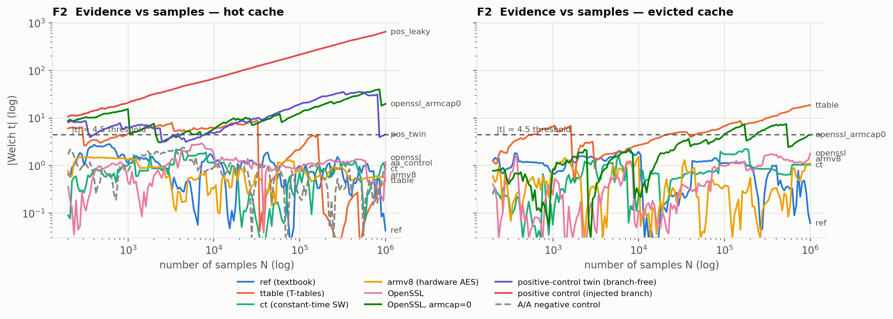

<!-- _class: lead -->
<!-- _paginate: false -->

# AES Under the Microscope

## Same cipher. Same output. **Different timing?**

Timing side-channel leakage in five AES-128 implementations on Apple M4

C++20 · OpenSSL 3.6.1 · Apple M4 · macOS 26.4.1

---

## AES-128 in one picture

- 128-bit block → **4×4 byte state**, filled column by column
- 128-bit key → **11 round keys** (176 bytes), via RotWord · SubWord · Rcon
- Initial AddRoundKey, then **10 rounds**:

| Rounds 1–9 | Round 10 |
|---|---|
| SubBytes → ShiftRows → MixColumns → AddRoundKey | SubBytes → ShiftRows → AddRoundKey |

- The final round has no MixColumns: it is linear, so it would add nothing there

Our implementation reproduces **FIPS-197 C.1** `69c4e0d86a7b0430d8cdb78070b4c55a` and **SP 800-38A**

---

## The maths that matters: GF(2⁸)

- Bytes are polynomials mod **m(x) = x⁸ + x⁴ + x³ + x + 1** (irreducible ⇒ a field)
- Addition = XOR · `xtime(a) = (a≪1) ⊕ (0x1B · a₇)`
- **S-box** = affine( a⁻¹ ), with a⁻¹ = a²⁵⁴
  - inversion → non-linearity
  - affine map → no fixed points
- **MixColumns** = multiply by c(x) = {03}x³+{01}x²+{01}x+{02} mod x⁴+1
  - MDS matrix: one changed byte affects all four bytes of its column

The constant-time version **computes** a²⁵⁴ instead of looking it up

---

## Timing side channels

**Secret-dependent branch:** `if (secret) do_more_work();` → time reveals the bit

**Secret-dependent memory access:** `T[secret]` → which cache line is touched reveals the secret
(Bernstein 2005 · Osvik, Shamir & Tromer 2006)

**Defences:** no secret-indexed tables, no secret branches, or hardware AES

**Apple-specific caveat:** prefetchers and predictors can break "constant-time" source reasoning (GoFetch 2024 · SLAP, FLOP 2025)

---

## Five implementations, leaky → hardware

| | Strategy | Secret-indexed loads | Latency |
|---|---|---|---|
| `ref` | textbook, 256 B S-box | 32 | 169 ns |
| `ttable` | 4 × 1 KB T-tables | 32 | 36 ns |
| `ct` | computed S-box, no tables | **0** | 2,559 ns |
| `armv8` | `AESE`/`AESMC` hardware | **0** | **7.2 ns** |
| `openssl` | EVP, default path | 0 | 8.0 ns |

All five agree on **100,000 random inputs** · ASan/UBSan clean

---

## Methodology: fixed-vs-random (TVLA / dudect)

- Each sample: coin flip → **fixed** input or **random** input → time **B** encryptions
- Welch t = (x̄_F − x̄_R) / √(s²_F/n_F + s²_R/n_R) · **|t| > 4.5 ⇒ leakage detected**
- 10⁶ samples per test · two cache conditions: **hot** and **evicted** (4 MB flush, B = 1)
- **Controls:**
  - **negative:** A/A, random vs random
  - **positive:** an *injected* secret-dependent branch (educational, not a weakness of AES)
- 5 hypotheses **written down before collecting data**

Timer: mach_absolute_time, 24 MHz = 41.67 ns/tick (not a cycle counter)

---

<!-- _class: lead -->

# Live demo

Round Explorer → Speed → **Leakage Race** → **Key Recovery** → Compiler → Scorecard

`scripts/demo.sh` · fully offline · every number from the C++ binary

---

## Results

| Test | \|t\| |
|---|---|
| positive control | **655** |
| A/A control | 1.02 |
| **ttable, evicted** | **18.8** (+3.1 ns) |
| ttable, hot | 0.48 |
| ct / armv8 | ≤ 1.10 |
| OpenSSL default | ≤ 1.79 |
| OpenSSL armcap=0, hot | **19.8**\* |

\* table-based code in the hot regime: confounded (see Limitations)

---

## Under the hood: source ≠ machine code

| | Assembly |
|---|---|
| Positive control, `-O2` | `tbnz w0, #7` → the branch **survives** |
| Positive control, `-O0` | `subs w8,w8,#128 ; b.ge` |
| Twin, `-O2` | `bic / neg / and / orr`: mask, no branch |
| `ttable` | `ldr w9, [x14, w9, uxtw #2]`: **secret address** |
| `ct` S-box | 917 instructions, **0 branches, 0 indexed loads** |
| `armv8` | 60 × `aese`, 54 × `aesmc` |
| OpenSSL default | `aes_v8_ecb_encrypt` (hardware) |
| OpenSSL `armcap=0` | `AES_encrypt` (portable C, 4.5× slower) |

---

## Limitations & Apple Silicon specifics

- **24 MHz timer** → batched samples, weak bounds for single-encryption tests
- **No core pinning** on macOS (QoS hint only) · one machine, one compiler
- **Unexpected:** branch-free code with a data-dependent load was flagged in the *hot, long-batch* regime (|t| 4.5–14)
  - not caused by input preparation or the fixed value · gone at B ≤ 10
  - mechanism **unexplained** (predictor state? see SLAP/FLOP)
  - so cache conclusions rest on the **evicted** runs
- Statistical detection ≠ exploitability · non-detection ≠ proof of constant time

---

## Conclusions

| H | Hypothesis | Verdict |
|---|---|---|
| H0 | A/A stays below 4.5 | ✔ 1.02 |
| H1 | Injected branch detected | ✔ 655 |
| H2 | T-table leaks under eviction | ✔ 18.8 |
| H3 | `ct` and `armv8` show nothing | ✔ ≤ 1.10 |
| H4 | OpenSSL depends on its code path | ✔ HW vs C fallback |

**Take-aways:**
- Use hardware AES: fastest *and* quietest, but check it is really selected
- "Constant-time" is a property of machine code on a CPU, not of source code

**Future work:** cycle counters · DIT on whole implementations · Prime+Probe · bit-sliced AES
