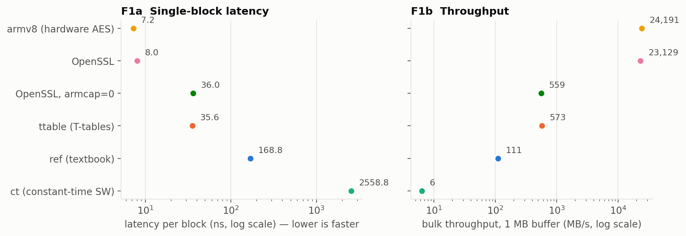
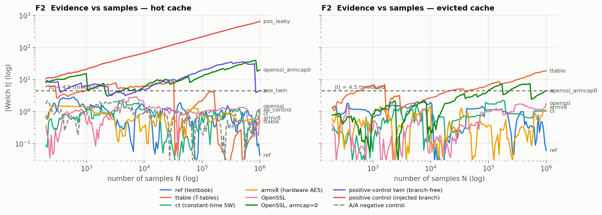
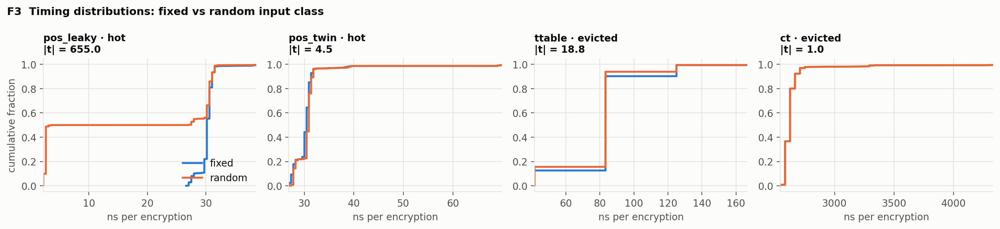
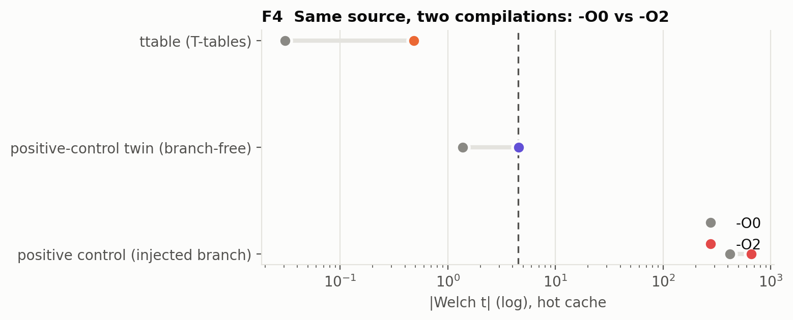
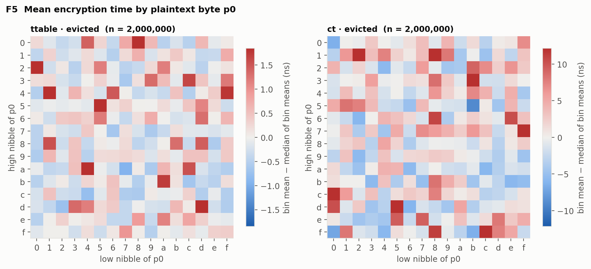

# AES Under the Microscope
### An Experimental Study of Timing Side-Channel Leakage in AES-128 on Apple M4

*Course project report · Cryptography*

---

## Abstract

AES-128 is mathematically secure, but a software implementation can still
reveal secrets through how long it takes to run. We implemented AES-128
four ways in C++20 (a textbook version, a classic T-table version, a
constant-time version with a computed S-box, and one using the ARMv8 AES
instructions) and compared them with OpenSSL 3.6.1. All five reproduce the
FIPS-197 and NIST SP 800-38A test vectors and agree on 100,000 random inputs.

On an Apple M4 we applied the fixed-vs-random Welch t-test used in leakage
assessment (TVLA, dudect), with 10⁶ samples per configuration, a negative
control (A/A), and a positive control (an intentionally injected
secret-dependent branch). The positive control was detected at |t| = 655, and
the negative control stayed at |t| = 1.02. With the cache flushed before every
encryption, the **T-table implementation leaked (|t| = 18.8, 3.1 ns per
encryption)**. The constant-time and hardware implementations showed no
detectable leakage (|t| ≤ 1.10). OpenSSL used the hardware instructions by
default and showed no leakage. When hardware detection was disabled, it fell
back to a portable C routine that ran 4.5× slower and was flagged (|t| = 19.8).

We also report a result we did not expect: in the hot-cache, long-batch
regime, branch-free code that performs a data-dependent table load can be
flagged by the test (|t| ≈ 4.5–14). We could not fully explain this effect,
so hot-cache detections of table-based code are treated as inconclusive.

A toy attack recovers a secret key byte from timing alone, but only against
the injected branch. Against the constant-time implementation it gets
nothing. The project makes no key-recovery claim against AES or any of the
five implementations.

---

## 1. Introduction

The Advanced Encryption Standard (AES) has withstood more than two decades
of cryptanalysis. Attacks on deployed AES, however, rarely target the
mathematics. They target the *implementation*. Kocher [4] showed in 1996
that execution time can leak secret keys, and Bernstein [5] and Osvik,
Shamir and Tromer [6] showed that the table lookups in fast software AES leak
key material through the CPU cache.

This project asks a narrow, testable question:

> On Apple M4, do different AES-128 implementation strategies show
> statistically detectable data-dependent timing under a standard
> fixed-vs-random leakage test? And how much of the outcome comes from the
> source code, the compiled machine code, and the microarchitecture?

We separate five levels of claim throughout:

1. source-level behaviour
2. machine-code behaviour
3. runtime timing
4. statistical evidence of leakage
5. practical exploitability

This report provides evidence for levels 1–4 only. **Statistical detection
is not exploitability, and non-detection is not a proof of constant time.**

**Contributions:**

- Five AES-128 implementations, validated against official test vectors.
- A reusable timing harness with randomised class interleaving.
- Pre-registered hypotheses with positive and negative controls.
- Assembly-level verification of the security-relevant properties.
- An offline interactive dashboard that replays the recorded experiments.

---

## 2. Background: the mathematics of AES-128

### 2.1 The state and the round structure

AES-128 encrypts a 128-bit block under a 128-bit key. The block is held as a
4×4 matrix of bytes, the *state*, filled column by column:
$s_{r,c} = \text{in}[r + 4c]$. After an initial key addition, AES-128 applies
10 rounds. Rounds 1–9 apply

$$\text{SubBytes} \rightarrow \text{ShiftRows} \rightarrow \text{MixColumns} \rightarrow \text{AddRoundKey},$$

and round 10 omits MixColumns.

### 2.2 The finite field GF(2⁸)

AES treats each byte $b_7 b_6 \ldots b_0$ as a polynomial
$b_7x^7 + \cdots + b_1x + b_0$ with coefficients in GF(2). Arithmetic is
done modulo the irreducible polynomial

$$m(x) = x^8 + x^4 + x^3 + x + 1 \quad (\texttt{0x11B}).$$

Because $m(x)$ is irreducible, every non-zero element has a multiplicative
inverse, so the 256 byte values form a field. **Addition** is bitwise XOR.
**Multiplication by $x$** (`xtime`) is a left shift followed by a
conditional XOR with `0x1B` when the top bit overflows:

$$\text{xtime}(a) = (a \ll 1) \oplus (\texttt{0x1B} \cdot a_7).$$

General multiplication is repeated `xtime` and XOR. Our implementation
reproduces the FIPS-197 examples $\{57\}\cdot\{83\} = \{\text{c1}\}$ and
$\{57\}\cdot\{13\} = \{\text{fe}\}$. Our `xtime` uses a mask
($\texttt{0x1B} \mathbin{\&} -(a \gg 7)$) instead of an `if`, so it has no
data-dependent branch.

### 2.3 SubBytes and the S-box

SubBytes is the only non-linear step. Without it, AES would be a linear map
over GF(2) and could be broken by solving linear equations. Each byte is
replaced by

$$S(a) = A\!\left(a^{-1}\right) \oplus \texttt{0x63},$$

where $a^{-1}$ is the inverse in GF(2⁸) (with $0^{-1} := 0$) and $A$ is an
affine map over GF(2):
$b \mapsto b \oplus \text{rotl}(b,1) \oplus \text{rotl}(b,2) \oplus \text{rotl}(b,3) \oplus \text{rotl}(b,4)$.

- **Inversion** provides strong non-linearity (low differential and linear
  probability).
- **The affine map** destroys the simple algebraic structure of pure
  inversion, and makes $S$ have no fixed points ($S(a) \neq a$) and no
  opposite fixed points ($S(a) \neq \bar a$).

Since the multiplicative group has order 255, $a^{255} = 1$ and therefore
$a^{-1} = a^{254}$. Our constant-time implementation computes this with a
fixed chain of 11 multiplications. Our 256-entry S-box *table* is generated
at compile time from the same definition, and a test checks the two agree on
all 256 inputs.

### 2.4 ShiftRows and MixColumns

**ShiftRows** rotates row $r$ left by $r$ positions, so each column's bytes
are spread across all four columns.

**MixColumns** treats each column as a polynomial over GF(2⁸) and multiplies
it by $c(x) = \{03\}x^3 + \{01\}x^2 + \{01\}x + \{02\}$ modulo $x^4 + 1$.
Equivalently, it multiplies the column by the circulant matrix

$$\begin{pmatrix} 02 & 03 & 01 & 01 \\ 01 & 02 & 03 & 01 \\ 01 & 01 & 02 & 03 \\ 03 & 01 & 01 & 02 \end{pmatrix}.$$

The matrix is MDS (maximum distance separable): a change in $k$ input bytes
of a column changes at least $5-k$ output bytes. Together with ShiftRows,
this gives full diffusion after two rounds. Finite-field arithmetic is what
makes the matrix invertible and its diffusion guaranteed.

**Why the final round omits MixColumns.** MixColumns is linear, so in the
last round an attacker could simply undo it. It adds no security there.
Omitting it also gives the inverse cipher the same structure as the forward
cipher.

### 2.5 Key expansion

The 16-byte key becomes 44 words $w_0, \ldots, w_{43}$ (11 round keys,
176 bytes). The first four words are the key itself. Then

$$w_i = w_{i-4} \oplus \begin{cases} \text{SubWord}(\text{RotWord}(w_{i-1})) \oplus \text{Rcon}_{i/4} & i \equiv 0 \pmod 4 \\ w_{i-1} & \text{otherwise,} \end{cases}$$

with $\text{Rcon}_j = x^{j-1}$ in GF(2⁸). The round constants break the
symmetry between rounds. Our implementation reproduces the FIPS-197
Appendix A.1 expansion, including the last round key
`d014f9a8 c9ee2589 e13f0cc8 b6630ca6`.

---

## 3. Background: timing side channels

A timing side channel exists when the time an operation takes depends on
secret data. Two mechanisms matter here:

- **Secret-dependent branches.** If the code does more work when a secret
  bit is set, the extra time reveals the bit.
- **Secret-dependent memory accesses.** A lookup `T[secret]` touches a cache
  line determined by the secret. If an attacker can influence or observe
  which lines are cached, the access pattern leaks [5, 6]. T-table AES
  performs 160 such lookups per block.

The standard defences are to avoid secret-indexed tables (bit-slicing [9],
vector permutes [10], or computing the S-box) or to use hardware
instructions. Recent work shows that *microarchitectural* features of Apple
processors can undermine source-level "constant-time" reasoning:

- The data memory-dependent prefetcher (GoFetch [11]).
- Load-value prediction (FLOP [13]).
- Load-address prediction (SLAP [14]).

**Fixed-vs-random testing.** The non-specific TVLA test [7], adapted to
software as *dudect* [8], measures many executions with inputs drawn from
two classes:

- a **fixed** input, the same every time
- a **random** input, fresh every time

It then compares the two timing distributions with Welch's t-test [12]:

$$t = \frac{\bar x_F - \bar x_R}{\sqrt{s_F^2/n_F + s_R^2/n_R}}.$$

$|t| > 4.5$ is the conventional threshold for "leakage detected" (roughly
$p < 10^{-5}$). The test asks *whether* timing depends on the data, not
*how*, and it says nothing about exploitability.

---

## 4. Implementations

| ID | Strategy | Secret-indexed loads | Secret branches |
|---|---|---|---|
| `ref` | Textbook FIPS-197 transformations, 256-byte S-box table | 32 (verified in assembly) | none |
| `ttable` | Four 1 KB T-tables combining SubBytes, ShiftRows, MixColumns | 32 per round loop + final round | none |
| `ct` | S-box computed as $A(a^{254})$, 8 bytes in parallel (SWAR) | **0** | **0** |
| `armv8` | `AESE`/`AESMC` hardware instructions | 0 (S-box inside the execution unit) | 0 |
| `openssl` | OpenSSL 3.6.1 EVP AES-128-ECB, context reused | path-dependent (§9.5) | – |

`ref` and `ttable` are labelled in the source as **educational, not suitable
for protecting real secrets**.

**ECB.** ECB mode is used only as a single-block interface for measurement.
It must never be used for real data.

**Positive control (intentionally vulnerable).** `pos_leaky` runs the
hardware AES and then computes $s = S[p_0 \oplus k_0]$ (the first-round
S-box output for byte 0). If $s < \texttt{0x80}$, it runs a fixed workload
of 64 dependent multiply-adds. Its twin `pos_twin` always does the work and
selects the result with a bit mask. Both return identical results (tested
for all 256 values of $s$). **This branch is injected on purpose. It is not
a weakness of AES.**

---

## 5. Correctness

All correctness tests pass. They run through `ctest`, and the timing
commands refuse to run unless an internal self-test passes.

| Test | Result |
|---|---|
| FIPS-197 C.1: key `00…0f`, pt `00112233…ff` → `69c4e0d86a7b0430d8cdb78070b4c55a` | ✔ all 7 variants |
| FIPS-197 Appendix B ciphertext + round-1 intermediate states | ✔ |
| FIPS-197 A.1 key expansion (round keys 1 and 10) | ✔ |
| NIST SP 800-38A F.1.1 ECB-AES128, blocks 1–4 | ✔ all 7 variants |
| Computed S-box = table S-box (256 inputs); no fixed points | ✔ |
| GF(2⁸): FIPS-197 examples; $a \cdot a^{-1} = 1$ for all $a \neq 0$ | ✔ |
| 100,000 random (key, plaintext) pairs, all implementations agree | ✔ |
| Bulk ECB path = block-by-block | ✔ |
| Debug build under AddressSanitizer + UndefinedBehaviorSanitizer | ✔ no findings |

---

## 6. Methodology

### 6.1 Measurement

| Aspect | Choice |
|---|---|
| Timer | `mach_absolute_time()` with `isb` barriers. Verified at runtime: timebase 125/3, i.e. **41.67 ns per tick (24 MHz)**. This is not a cycle counter |
| Sample | The time for $B$ back-to-back encryptions of the same input. $B$ is calibrated so that a sample lasts about 2.5 µs |
| Cache conditions | **Hot** (no eviction) and **evicted**: before every sample, a 4 MB buffer (32× the 128 KB L1D) is read at the 128-byte line stride, and $B = 1$ |
| Protocol | For each of $N = 10^6$ samples, a fair coin picks the class. Both classes are prepared by identical instructions outside the timed region. Classes are interleaved randomly to cancel drift |
| Key and fixed input | Key = FIPS-197 C.1 test key. Fixed plaintext = all zeros (so the first-round S-box indices equal the key bytes) |
| Controls | **Negative:** A/A, both classes random, on the leaky positive control itself. **Positive:** the injected branch (§4) |
| Hygiene | Thread QoS set to `USER_INTERACTIVE`, which biases scheduling towards performance cores (macOS has no hard affinity API). AC power, Low Power Mode off. All metadata is recorded with every run |

### 6.2 Statistics

- **Primary statistic, fixed in advance:** Welch's t on all samples, threshold $|t| > 4.5$.
- **Secondary statistics:**
  - $|t|$ after dudect-style cropping at the 50th, 90th and 99th pooled percentiles
  - Mann–Whitney U and Kolmogorov–Smirnov tests
  - Cohen's $d$
  - Holm-adjusted p-values across all 19 tests
  - the *minimum detectable difference* $4.5\sqrt{s_F^2/n_F + s_R^2/n_R}$, which bounds every non-detection

### 6.3 Pre-registered hypotheses

| ID | Hypothesis |
|---|---|
| H0 | The A/A negative control gives \|t\| < 4.5 |
| H1 | The positive control gives \|t\| ≫ 4.5 |
| H2 | T-table AES leaks under cache eviction (and may not in a hot loop, because 4 KB of tables fits in a 128 KB L1D) |
| H3 | `ct` and `armv8` show no detectable leakage |
| H4 | OpenSSL's behaviour depends on its selected code path |

---

## 7. Experimental setup

| | |
|---|---|
| Machine | MacBook Air, Apple M4 (`Mac16,12`): 4 performance + 6 efficiency cores |
| Caches | L1D 128 KB per P-core, L2 16 MB per P-cluster, 128-byte lines |
| CPU features | `FEAT_AES` = 1, `FEAT_DIT` = 1 |
| OS | macOS 26.4.1 |
| Compiler | Apple LLVM 21.0.0, `-O2 -mcpu=apple-m4` (E5 also uses `-O0`) |
| OpenSSL | 3.6.1 (Homebrew) |
| Power | AC power, Low Power Mode off |
| Run | `results/full-20261117-0301`, collected with `scripts/collect.sh` |

---

## 8. Results

### 8.1 Performance (E2)

| Implementation | Latency ns/block (median ± sd) | Throughput, 1 MB (MB/s) |
|---|---|---|
| armv8 | 7.24 ± 0.26 | 24,191 |
| openssl (default) | 8.01 ± 0.07 | 23,129 |
| ttable | 35.58 ± 0.29 | 573 |
| openssl, `OPENSSL_armcap=0` | 36.05 ± 0.48 | 559 |
| ref | 168.78 ± 2.90 | 111 |
| ct | 2558.79 ± 26.94 | 6.4 |

The hardware instructions are about 353× faster than our constant-time
software, which pays for its safety by computing the S-box with 11
GF(2⁸) multiplications per byte. Bit-sliced and vector-permute
implementations [9, 10] reduce this gap; ours was written for clarity.

### 8.2 Leakage (E3, E4)

| Experiment | Cache | B | \|t\| | Fixed ns | Random ns | Δ ns | Min. detectable ns | Verdict |
|---|---|---|---|---|---|---|---|---|
| **pos_leaky** (positive control) | hot | 94 | **654.98** | 30.34 | 16.58 | +13.77 | 0.095 | leak detected |
| aa_control (negative control) | hot | 94 | 1.02 | 16.56 | 16.53 | +0.03 | 0.128 | no evidence |
| pos_twin (branch-free) | hot | 93 | 4.53 | 31.12 | 31.47 | −0.35 | 0.343 | flagged (§9.2) |
| ref | hot | 19 | 0.04 | 146.87 | 146.87 | −0.00 | 0.283 | no evidence |
| ref | evicted | 1 | 0.06 | 195.80 | 195.78 | +0.02 | 1.59 | no evidence |
| ttable | hot | 95 | 0.48 | 28.57 | 28.66 | −0.09 | 0.790 | no evidence* |
| **ttable** | **evicted** | 1 | **18.79** | 84.10 | 80.97 | **+3.13** | 0.751 | **leak detected** |
| ct | hot | 1 | 0.85 | 2638.40 | 2640.26 | −1.86 | 9.82 | no evidence |
| ct | evicted | 1 | 1.05 | 2717.91 | 2664.97 | +52.95 | 227.5 | no evidence |
| armv8 | hot | 2286 | 0.55 | 1.229 | 1.228 | +0.001 | 0.006 | no evidence |
| armv8 | evicted | 1 | 1.10 | 36.20 | 41.72 | −5.51 | 22.6 | no evidence |
| openssl | hot | 409 | 1.19 | 6.97 | 6.98 | −0.02 | 0.056 | no evidence |
| openssl | evicted | 1 | 1.79 | 40.15 | 40.53 | −0.39 | 0.981 | no evidence |
| **openssl, armcap=0** | **hot** | 78 | **19.83** | 33.77 | 34.17 | −0.40 | 0.091 | **leak detected*** |
| openssl, armcap=0 | evicted | 1 | 4.44 | 79.58 | 78.16 | +1.43 | 1.45 | no evidence (borderline) |

\* Hot-cache results for table-based code: see §9.2.

Figure F2 shows how the evidence accumulates. For a genuine leak, $|t|$
grows roughly as $\sqrt N$ (the positive control rises in a straight line
on log–log axes). For no leak, it wanders below the threshold. T-table under
eviction keeps rising, and stays above 4.5 from $N \approx 4.5\times10^4$
(the last sample count at or below the threshold is 44,739).

### 8.3 Hypothesis verdicts

| ID | Verdict | Key evidence |
|---|---|---|
| H0 | ✔ supported | A/A \|t\| = 1.02 (also 0.72 at `-O0`) |
| H1 | ✔ supported | \|t\| = 655; the branch costs 13.8 ns per call on average |
| H2 | ✔ supported | evicted \|t\| = 18.79, +3.13 ns; robust tests agree (Mann–Whitney p < 10⁻³⁰⁰) |
| H3 | ✔ supported | largest \|t\| = 1.10 across `ct` and `armv8` in both conditions |
| H4 | ✔ supported | default → `aes_v8_ecb_encrypt` at 8.0 ns; `armcap=0` → `AES_encrypt` at 36.1 ns, and that path is flagged |

### 8.4 Compiler behaviour (E5)

The injected branch survives both compilations (§10) and is detected at
both: |t| = 417 at `-O0` and 655 at `-O2`. At `-O0` the twin is clean
(|t| = 1.38), while at `-O2` it is marginally flagged (|t| = 4.53). The
`-O0` code is about 6× slower, so the same per-sample effect is diluted.

### 8.5 Toy key recovery

To make "leakage" concrete, the attacker side of `recover` sees only
(plaintext byte, timing) pairs and the public S-box. For each guess $g$ it
correlates the mean time per $p_0$ with the predicted pattern
$[S(p_0 \oplus g) < \texttt{0x80}]$.

- **Against the injected branch:** the secret byte `0x3C` was ranked first
  at the first checkpoint (2,500 timings) and stayed first (correlation 1.000).
- **Against `ct`:** the true byte finished ranked 77 of 256. Across 3 secrets
  × 2 seeds, its score was within ±1.05 standard deviations of the 256
  guesses, i.e. consistent with noise.

**This is a toy.** The leak exists only because we injected it.

### 8.6 Per-byte timing profile

Even with 2×10⁶ evicted samples, neither the T-table nor the constant-time
profile shows visible structure by plaintext byte $p_0$. The fixed-vs-random
test detects *that* the T-table implementation's timing depends on the data,
but locating *which* byte values are slow, as a real cache attack needs [5],
would require far more samples or a stronger attacker model (for example
Prime+Probe [6]). Detecting a leak is much easier than exploiting it.

---

## 9. Discussion

### 9.1 What the clean results show

The cache condition matters, as H2 predicted. In a hot loop, the M4's
128 KB L1D holds all 4 KB of T-tables and the mean timing showed no
difference (|t| = 0.48). Once the cache is flushed before every encryption,
which approximates an attacker who evicts the victim's data, the T-table
implementation leaks: 3.1 ns per encryption on an 81 ns operation.

Interestingly, the *fixed* class is slower. A simple miss-count model
predicts the opposite: the all-zero plaintext makes all first-round lookups
of a table fall into one cache line. We therefore report the direction as
observed, without a confirmed mechanism. Plausible contributors include
serialised fills of a single line and memory-level parallelism differences
between the classes.

The textbook `ref` implementation did not leak, even under eviction. Its
256-byte S-box occupies only two 128-byte lines, so after the first lookup
of a block almost every access hits. Small tables leak far less than large
ones on a 128-byte-line machine.

`ct` and `armv8` showed no evidence in either condition, consistent with the
assembly (no secret-indexed loads, no secret branches). The non-detections
are bounded: for `armv8` hot, any mean difference above 0.006 ns would have
been detected. For the evicted runs the bound is weak (22.6 ns for `armv8`,
227.5 ns for `ct`), because a single encryption lasts less than one timer
tick and eviction adds large variance.

### 9.2 An unexpected result: branch-free code flagged in the hot regime

The branch-free twin was flagged in development runs (|t| = 6–15 at
$N = 2\times10^5$) and marginally in the final run (|t| = 4.53 at $10^6$).
We investigated, time-boxed, and recorded each step in the lab notebook:

| Hypothesis or check | Outcome |
|---|---|
| Assembly: is the twin really branch-free? | Yes |
| The input-preparation path differs between classes | Fixed; effect persisted |
| The choice of fixed plaintext | Four choices, all flagged |
| Each component in isolation (workload, gate, S-box load), with DIT on and off | No effect |
| Loaded address vs loaded value, separated | No effect in isolation |
| Dependence on batch size | Present only for long same-input batches ($B \ge 94$), absent at $B \le 10$ |
| Hardware AES on its own | Never shows it |

Rank-based tests reveal the same regime-dependence for T-table hot: its mean
difference is negligible, but Mann–Whitney p < 10⁻³⁰⁰, so the distributions
differ in shape.

A plausible but **unconfirmed** explanation is microarchitectural state that
persists across samples. The fixed class repeats identical inputs and can
benefit from predictors trained on earlier fixed samples (for example the
load-address or load-value predictors reported on recent Apple cores
[13, 14]). The random class cannot.

**Consequences:**

1. On this platform, hot-cache, long-batch fixed-vs-random detections of
   code with data-dependent loads cannot be attributed to cache leakage on
   their own. This is why the OpenSSL fallback's hot result (|t| = 19.8) is
   marked with an asterisk.
2. Our cache conclusions rest on the evicted runs ($B = 1$), where the
   effect was absent.
3. This is a concrete example of why statistical detection must not be read
   as an explained, exploitable leak.

### 9.3 Mean versus robust statistics

The full-data mean t is sensitive to rare, extreme outliers (interrupts). In
Figure F2, the twin and the OpenSSL fallback curves drop sharply near
$N \approx 8\times10^5$ when a burst of outliers lands in one class. Cropped
statistics (dudect) and rank tests are more stable but can inflate
detections, especially with tick-quantised data. We fixed the primary
statistic in advance and report the others alongside it, rather than picking
whichever looks best.

### 9.4 Source, machine code, runtime

The project's central distinction held up at every level:

- **Source to machine code.** The `if` stayed a branch at both `-O0` and `-O2`.
  Clang rewrote one multiplication in `ct` into shift-and-subtract, but kept
  it branch-free.
- **Machine code to runtime.** Code with no secret branch and no
  secret-indexed load still produced fixed-vs-random differences under
  specific conditions (§9.2).
- **Runtime to statistics.** A significant |t| depends on cache condition,
  batch size, and the statistic chosen.

### 9.5 OpenSSL

Debugger breakpoints confirmed that, by default, OpenSSL runs
`aes_v8_ecb_encrypt`, i.e. the AES instructions. With `OPENSSL_armcap=0`
it skips both hardware and vector-permute code and runs the portable C
`AES_encrypt`, whose speed (36 ns) matches our T-table implementation and
which was flagged in the hot test. The default configuration on this machine
is therefore the safe one. Silently disabling capability detection (for
example under emulation, or in a restricted environment) would change both
performance and leakage.

---

## 10. Assembly observations

Full listings and annotations are in `assembly/README.md`.

- **`ref`:** 32 `ldrb w, [x_sbox, x_index]` loads, where the index is a
  state byte. **`ttable`:** 32 `ldr w, [x_table, w_index, uxtw #2]` loads.
  These are the secret-dependent addresses.
- **`ct`:** the parallel S-box `sbox8` is 917 straight-line instructions,
  with 0 branches and 0 indexed loads. The only branches in `encrypt_block`
  are the fixed 9-iteration round loop and the stack-protector check.
  A remaining assumption is that `mul` has data-independent latency, which
  Apple ties to the DIT bit.
- **`armv8`:** 60 `aese` and 54 `aesmc` instructions.
- **Positive control:**
  - At `-O2`: `tbnz w0, #7, …` followed by a tail call. The compiler kept
    the branch (it cannot speculate a 64-iteration loop into a `csel`).
  - At `-O0`: `subs w8, w8, #128; b.ge …`.
  - The twin uses `bic`/`neg`/`and`/`orr`, a mask-based select.
- **OpenSSL:** `libcrypto.3.dylib` contains 4,190 `aese` instructions and
  four AES families (`aes_v8_*`, `vpaes_*`, `bsaes_*`, and the C `AES_encrypt`).

---

## 11. Limitations

- **Timer:** 41.67 ns resolution. Samples are batches, and single-encryption
  evicted samples are heavily quantised (weak bounds on non-detection).
- **No cycle counters:** Apple Silicon's cycle counters need private
  frameworks and root, so we used none.
- **Scheduling:** there is no core pinning on macOS, only a QoS hint. The
  P/E-core placement of each sample is unknown.
- **One machine, one OS build, one compiler.** Conclusions are specific to
  this platform.
- **Attacker model:** in-process, with an idealised attacker who can flush
  the whole cache. No cross-process or remote attack was attempted.
- **Hot-regime effect:** the confounding effect in §9.2 is unexplained. More
  work (performance counters, DIT/DOIT on whole implementations, alternative
  batching) would be needed to identify it.
- **Single fixed plaintext and key** per test. Other fixed classes could
  reveal other dependencies.
- **Live dashboard runs are illustrative only.** The browser competes for
  the CPU. All reported numbers come from the recorded run.

---

## 12. Security implications

1. **Table-based AES should not protect secrets on systems where an attacker
   can influence the cache.** Even on a large-L1 machine, eviction made the
   leak visible within about 4.5×10⁴ measurements.
2. **Use the hardware instructions** (or a vetted constant-time library that
   uses them). They were the fastest *and* showed no leakage. Verify that the
   hardware path is actually selected: OpenSSL's fallback is table-based.
3. **"Constant-time" is a property of machine code on a specific CPU**, not
   of source code. Inspect the assembly. Then test empirically with controls,
   and interpret detections and non-detections against a stated sensitivity.
4. **Statistical leakage tests need controls.** Without the A/A control we
   could not show that the harness is calibrated. Without the positive
   control we could not show it can detect anything. Without the branch-free
   twin we would have missed the confound in §9.2.

---

## 13. Conclusion

All five AES-128 implementations are functionally identical but behave very
differently in time. Under a standard fixed-vs-random test on Apple M4:

- the injected branch leaks massively
- T-table AES leaks once the cache is flushed
- our constant-time software AES and the ARMv8 instructions show no detectable leakage
- OpenSSL is safe by default but falls back to a leaky path when hardware detection is disabled

The most instructive result was the one we did not plan: branch-free code
can still be flagged on a modern microarchitecture, which shows why
source-level reasoning, assembly inspection, and statistics must be read
together and never in isolation.

**Future work:**

- cycle-accurate measurement with performance counters
- running whole implementations with DIT enabled
- a Prime+Probe attacker model
- bit-sliced constant-time AES
- identifying the mechanism behind §9.2

---

## References

1. NIST, *FIPS 197: Advanced Encryption Standard (AES)*, 2001 (updated 2023).
2. NIST, *SP 800-38A: Recommendation for Block Cipher Modes of Operation*, 2001.
3. J. Daemen and V. Rijmen, *The Design of Rijndael: AES – The Advanced Encryption Standard*, Springer, 2002.
4. P. C. Kocher, "Timing Attacks on Implementations of Diffie-Hellman, RSA, DSS, and Other Systems," CRYPTO 1996, LNCS 1109. doi:10.1007/3-540-68697-5_9
5. D. J. Bernstein, "Cache-timing attacks on AES," technical report, 2005.
6. D. A. Osvik, A. Shamir, and E. Tromer, "Cache Attacks and Countermeasures: the Case of AES," CT-RSA 2006, LNCS 3860. doi:10.1007/11605805_1
7. G. Goodwill, B. Jun, J. Jaffe, and P. Rohatgi, "A testing methodology for side-channel resistance validation," NIST Non-Invasive Attack Testing Workshop, 2011.
8. O. Reparaz, J. Balasch, and I. Verbauwhede, "Dude, is my code constant time?," DATE 2017. doi:10.23919/DATE.2017.7927267
9. E. Käsper and P. Schwabe, "Faster and Timing-Attack Resistant AES-GCM," CHES 2009. doi:10.1007/978-3-642-04138-9_1
10. M. Hamburg, "Accelerating AES with Vector Permute Instructions," CHES 2009. doi:10.1007/978-3-642-04138-9_2
11. B. Chen et al., "GoFetch: Breaking Constant-Time Cryptographic Implementations Using Data Memory-Dependent Prefetchers," USENIX Security 2024.
12. B. L. Welch, "The generalization of 'Student's' problem when several different population variances are involved," *Biometrika* 34, 1947.
13. J. Kim, J. Chuang, D. Genkin, and Y. Yarom, "FLOP: Breaking the Apple M3 CPU via False Load Output Predictions," USENIX Security 2025.
14. J. Kim, D. Genkin, and Y. Yarom, "SLAP: Data Speculation Attacks via Load Address Prediction on Apple Silicon," IEEE S&P 2025. doi:10.1109/SP61157.2025.00098

*Disclaimer: the positive control is an intentionally injected,
educational vulnerability. It is not a weakness of AES or of any
implementation evaluated here.*
